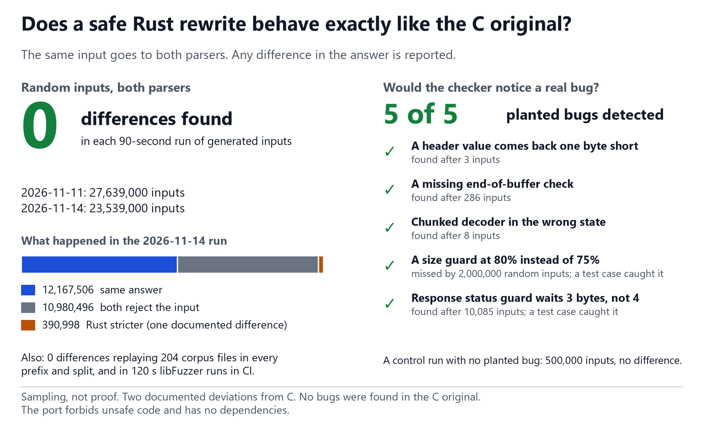

# Evidence and limits

Everything the README summarises, with the numbers and where each came from. The run categories
below (deterministic generated inputs, CI fuzzing, local runs) are separate and are never added
together.



*Sampling, not proof. Numbers come from [`data/`](data/); `scripts/make_hero.py` redraws the image.*

## What "matches picohttpparser" means

Only this: for every input the harness generates or replays, the C library
and the Rust port return the same thing. For a head parse that is the same verdict (complete,
partial or error), the same consumed length, and the same method, path, version, status,
reason and header names and values (as byte ranges into the input). For the chunked decoder it
is the same result after each call in a sequence of split reads, the same decoded bytes and
the same leftover. The only exceptions are the two documented deviations (D1, D2). It does not
mean the port is correct against RFC 9112, that it agrees with other parsers, or that no input
exists on which they differ. The check is sampling (a replayed corpus, property tests, a seeded
generator, and libFuzzer runs of a few minutes), not proof. Error detail is not compared, because C has
one failure code.

## Comparison with httparse

`httparse` 1.10.1 (pinned) is a third oracle in the harness. picohttpparser and fuzzdiff never
differ in these comparisons, while httparse differs from both in a fixed, documented set of classes.
This is a summary of the 2,000,000-input sweep and the curated cases in
[docs/DIFFERENTIAL_HTTPARSE.md](DIFFERENTIAL_HTTPARSE.md):

* httparse is stricter: obsolete line folding (RFC 9112 section 5.2), more than one SP
  between the request-line elements, `HTTP/1.x` with x other than 0 or 1, and octets
  0x80-0xFF in the request-target.
* picohttpparser (and so fuzzdiff by default) is stricter: more than one empty line before the
  request-line, a response status code outside 100-599, bare LF inside a chunk extension, and an
  empty chunk-size.
* Same verdict, different fields: extra SP before a reason phrase, and obs-text in a reason
  phrase (httparse returns an empty reason).
* Different cut-off on partial input: httparse rejects an already-invalid prefix before
  picohttpparser says "need more bytes".
* All three agree on, for example, rejecting whitespace before the colon, bare CR and NUL, and
  on accepting 0x80 in a field value.

Caveats: I only compared head parsing and the first chunk-size line (httparse has no chunked decoder),
with httparse in its default configuration, and on two parsers given one input, not a proxy and server pair.
I read the RFC statements in RFC 9112, RFC 9110 and RFC 3986 and quote them by section in the
document. Several of these classes matter when two components in a chain disagree about a message,
which is why I documented them. The repository contains no exploit of any system. A test fails if either side
changes in a way that creates a new class.

## How the comparison works

`compare(bytes)` decodes fuzzer bytes into a case (which of the four entry points, header
capacity, `last_len`, how a chunked body is split across calls), runs C and Rust, and returns

* `Equal`: same consumed length, fields and bytes, or both partial
* `BothReject`: both returned an error
* `RustStricter(D1 | D2)`: one of the two documented differences
* `Divergence`: a bug in one of the two; fails the tests and the CI fuzz job

## Demo: the harness catching seeded bugs

The `mutants` feature adds five deliberate bugs to the Rust parser:

1. a header value comes back one byte short past 16 bytes;
2. an end-of-buffer guard after the HTTP version is missing;
3. the chunked decoder is in the wrong state after a trailer line;
4. the chunk framing-overhead guard sits at 80% instead of 75%;
5. the response status guard waits for 3 bytes instead of 4.

I added the last two after a mutation sweep of the original three-bug suite found two one-line changes that
no test noticed. This is the output of a real run on 2026-11-11 (Windows, release build). I re-ran it on
2026-11-13 and got the same detections with slightly different timings.

```
$ cargo test --release -p fuzzdiff-harness --features mutants --test mutants -- --nocapture

mutant detection (deterministic generator, seed = input index + 1)
HeaderLenOffByOne: generator caught after 3 inputs in 67.8µs as ResultMismatch
MissingBoundsCheck: generator caught after 286 inputs in 1.0475ms as RustPanic
WrongStateAfterCrlf: generator caught after 8 inputs in 38.7µs as ResultMismatch
OverheadRatio: generator did not catch it in 2000000 inputs (6.1171773s)
OverheadRatio: targeted case #1 catches it as ResultMismatch
StatusGuard: generator caught after 10085 inputs in 30.7016ms as ResultMismatch
StatusGuard: targeted case #4 catches it as ResultMismatch
control (no mutant): 500000 inputs and 9 targeted cases, no divergence, 1.5069541s
```

(The test also prints the first failing input for each seeded bug, and a "no targeted case catches it" line for the first three; both are omitted here.)

What it shows and what it does not:

* `OverheadRatio` needs more than 100 KiB of chunk framing at between 75% and 80% overhead.
  The random generator never builds such an input, so a targeted case (`targeted_cases()` in
  `harness/src/generate.rs`) is what catches it. `StatusGuard` is found by the generator, but
  only after about 10,000 inputs; before the targeted case existed the test suite's shorter
  runs did not reach it.
* Both were also checked the plain way: editing `src/chunked.rs` (`/ 4` to `/ 5`) or
  `src/message.rs` (`< 4` to `< 3`) by hand and running `cargo test -p fuzzdiff-harness
  --test targeted`: each edit makes 2 of the 3 tests fail; with the source restored they pass.
* The first three mutants are easy for the generator (microseconds to milliseconds). That
  shows the plumbing works and that each bug class is visible. It does not show that the harness would find
  every subtle bug, and five seeded bugs are a small sample.

## The C SIMD path: window sweep and planted C bugs

The seeded bugs above are all in the Rust port. The C parser's SSE4.2 path (16 bytes per
instruction, byte loop for the tail) was only reached by CI on Linux. Two additions:

* `FUZZDIFF_C_SSE42=1` now also works with MSVC (it defines `__SSE4_2__`, which MSVC does not),
  so the SIMD path runs on a Windows machine and the Windows CI job. Under MSVC there is no
  ASan; the sanitizer runs stay on Linux.
* `harness/tests/simd_boundaries.rs`: 2,101,760 deterministic generated inputs. Five parser
  fields (method, request target, header name, header value, reason phrase), field lengths 0 to
  40 bytes (two full 16-byte blocks and a tail), every probe position, every one of the 256 byte
  values, each complete and cut off at the end of the field. Local run, SSE4.2 build under
  MSVC: 0 divergences from the Rust port (1,358,152 equal, 743,608 both reject). In CI it runs in
  the portable and SSE4.2 ASan/UBSan jobs, where an over-read past the exact-size heap copy would
  be reported.

To see whether these checks would notice a bug in the C SIMD code, `scripts/c_mutants.py` plants
one-line bugs in a temporary copy of the C file (`FUZZDIFF_C_DIR`; the vendored file is never
edited), builds the harness with the SSE4.2 path against it, and runs the existing checks
(corpus replay, property tests, targeted cases, 20 s of the seeded generator) and the sweep.
Raw output: [`data/c_mutants_run.txt`](data/c_mutants_run.txt). Local Windows run, 2026-11-15:

| Planted C bug | Effect | Existing checks | Window sweep |
|---|---|---|---|
| (none: unmodified C) | control | not caught | not caught |
| EolRangesNoDel | header value / reason scan no longer stops at DEL (0x7f) inside a 16-byte block | caught | caught |
| EolRangesNoUS | header value / reason scan misses byte 0x1f | caught | caught |
| TokenRangesNoBackslash | token scan (method, header name) no longer stops at ']' and backslash inside a block | caught | caught |
| TokenRangesNoHighBytes | token scan misses bytes 0x80-0xff inside a block | caught | caught |
| PathRangesNoDel | request-target scan no longer stops at DEL inside a block | caught | caught |
| FoundOffByOne | block scan treats a hit at offset 15 as 'nothing found' | caught | caught |
| GuardLongerThan16 | SIMD scan skipped when exactly 16 bytes remain (the byte loop handles them): expected to be behaviourally equivalent | not caught | not caught |

What this does and does not show:

* Six of six non-equivalent C bugs were caught by the existing checks and also by the sweep, so
  the sweep did not catch anything the older checks missed on this set. What the run adds is
  evidence that the SIMD path is exercised and that bugs in its character ranges are visible; the
  sweep is a deterministic, exhaustive version of what the seeded generator reaches by chance.
* The seventh edit is behaviourally equivalent (the byte loop does the same work), so
  "not caught" is the right answer for it.
* Six bugs written by me are a small sample. They are range-table and offset edits; bugs that
  only read out of bounds without changing results need the ASan jobs and were not part of this
  local run.

## Running things

```
make test         # cargo test --workspace
make lint         # fmt, clippy -D warnings (with and without the mutants feature)
make mutants      # the demo above
make miri         # Miri on the Rust crate (needs nightly with the miri component)
make httparse-table   # regenerate the tables in docs/DIFFERENTIAL_HTTPARSE.md
make cover        # cargo llvm-cov, fails under 90% lines
make bench        # criterion, C vs Rust
make quickfuzz    # 60 s of the seeded generator against both implementations
make seeds        # write the libFuzzer seed corpus (Linux fuzzing below)
make fuzz-diff fuzz-rust fuzz-c   # libFuzzer targets, need Linux, nightly, clang, cargo-fuzz
make fuzz-diff-sse42 fuzz-c-sse42 # the same with the C side built with -msse4.2
make asan         # cargo test with the C side under ASan and UBSan (Linux)
```

You need a C compiler (MSVC Build Tools or gcc/clang) for the `cc` crate. The build switches CI uses
are described at the top of `harness/build.rs`.

## Results

All numbers are from runs on one Windows machine (Ryzen 5 5600G, rustc 1.99.1, MSVC 19.39), except where the table says CI.

| Check | Result |
|---|---|
| `cargo test --workspace` | 40 tests pass (10 crate known-answer, 1 random invariant test, 1 harness unit test, 12 corpus replay, 1 SIMD window sweep, 5 property tests, 5 httparse class pins, 3 targeted cases, 2 doc tests), plus 1 mutant test with `--features mutants` |
| Miri, `cargo +nightly miri test -p fuzzdiff` (Rust crate only, `-Zmiri-strict-provenance`) | 13 tests pass, no undefined behaviour reported (local Windows run, and the `miri` CI job) |
| Property tests | 5 properties, 3000 cases each by default |
| Corpus replay | every file through every entry point, every prefix length with incremental `last_len`, every two-way chunked split, every byte value in every position of a valid message; 0 divergences |
| Seeded generator, 90 s release run | 27,639,000 inputs, 0 divergences (14.3M equal, 12.9M both reject, 0.46M rust-stricter by D1). A re-run on 2026-11-14 covered 23,539,000 inputs (the count depends on machine speed), also 0 divergences; both are in [`data/generator_runs.txt`](data/generator_runs.txt) |
| Seeded bugs | 5 of 5 detected (generator: 3, 286, 8 and 10,085 inputs; one needs a targeted case); 500,000-input control without a bug: clean |
| httparse comparison | 2,000,000-input sweep: 0 differences between picohttpparser and fuzzdiff; 0 disagreements with httparse that no known class explains, see [docs/DIFFERENTIAL_HTTPARSE.md](DIFFERENTIAL_HTTPARSE.md) |
| Line coverage of `src/` | 95.53% lines, 95.68% regions (cargo-llvm-cov in CI, tests from both crates; 95.88% in the earlier local run) |
| `cargo clippy -D warnings`, `cargo fmt --check` | clean, also with `mutants` |
| actionlint on both workflows | clean |
| Speed against C | Rust is about 1.4x to 1.5x slower on head parsing, level on chunked decoding, see [docs/BENCHMARKS.md](BENCHMARKS.md) |
| Bugs found in the C original | none |

## What has and has not run

Ran locally: everything in the table above.

Ran in CI on [pull request 3](https://github.com/samiali38183/fuzzdiff/pull/3), `ci` run
[43035685991](https://github.com/samiali38183/fuzzdiff/actions/runs/43035685991) and `fuzz` run
[43035685955](https://github.com/samiali38183/fuzzdiff/actions/runs/43035685955), all jobs green:

* `ci`: tests on Ubuntu and Windows, clippy, `mutants` detection, the httparse table check,
  cargo-deny, coverage (`--fail-under-lines 90`, passed at 95.53% lines), and Miri.
* `ci`, Miri: `cargo miri test -p fuzzdiff` on nightly, Linux, `-Zmiri-strict-provenance`.
  Scope: the pure-Rust crate (its known-answer tests, a pseudo-random invariant test and the
  doc tests). The C code and the FFI harness cannot run under Miri, so the differential
  comparison itself is not covered by it. Result: pass, no undefined behaviour reported. The
  crate is `#![forbid(unsafe_code)]`, so there is little for Miri to find; it is a check on that
  expectation, not new evidence about the C code.
* `ci`, sanitized C: the C parser is compiled with `-fsanitize=address,undefined
  -fno-sanitize-recover=undefined` by clang, and `cargo test --workspace --release` runs with
  `halt_on_error=1`, in two variants, the portable C path and `-msse4.2` (the SIMD path of the
  C parser, which the Windows runs could not reach before 0.2.1 work). ASan and UBSan reported nothing in the C
  code on the tests' inputs.
* `fuzz`, libFuzzer on nightly, 120 s per leg, seeded from `corpus/` (612 seed files per leg,
  cold cache), as printed by libFuzzer:

| Leg | What it runs | Executions | Time | Average exec/s | Coverage (cov / ft) | Result |
|---|---|---|---|---|---|---|
| `diff` | C (ASan, portable path) against Rust, panics on a divergence | 3,538,824 | 121 s | 29,246 | 937 / 3074 | no crash, no divergence |
| `diff-sse42` | the same with the C side built with `-msse4.2` | 5,881,336 | 121 s | 48,606 | 956 / 3084 | no crash, no divergence |
| `rust_only` | Rust only, debug assertions, output invariants | 7,547,353 | 121 s | 62,374 | 457 / 1519 | no crash |
| `c_only` | C only, ASan and UBSan, portable path | 5,731,452 | 121 s | 47,367 | 376 / 1111 | no crash, no sanitizer report |
| `c_only-sse42` | the same with `-msse4.2` | 5,856,004 | 121 s | 48,396 | 370 / 1050 | no crash, no sanitizer report |

The coverage figures are libFuzzer's edge counts over the instrumented code, so they are only
comparable between legs of the same target. The `diff-sse42` leg reaches more edges than `diff`, which
shows the SIMD branch is now part of what is fuzzed. Two minutes per leg is a smoke run and proves nothing
by itself.

The fuzz workflow runs each leg for 120 s on pull requests and is configured for 3600 s on a weekly
schedule (Monday 03:17 UTC); as of 2026-11-15 no scheduled run has happened yet, so no hour-long run
is on record. A manual run takes the number of seconds as an input.
Each leg restores its corpus from the most recent cache entry of the same leg
(`actions/cache`), merges the `corpus/` seeds on top, fuzzes, and saves the grown corpus under a
new key. The cache is best-effort: GitHub evicts entries unused for 7 days and caps repository
cache size, a cold cache just starts from the seeds, and a cache written by a pull request run
is readable only from that pull request's own later runs, so accumulation across weeks starts
with the first scheduled or manually dispatched run on `main`. Each run's log prints the
corpus file count before and after.
On pull request 3 the first run started the `diff` leg from the 612 seed files; the
second run (a later push) restored the cache entry of the first and started from 1,488 files,
ran 4,968,447 executions in 120 s, and ended with 2,513 files, which were saved for the next run.

Still not covered: the overhead guard and the `last_len > len` case (D2) are not reachable from
the libFuzzer targets (`-max_len=4096`, `last_len` clamped; the overhead guard needs over 100 KiB
of framing); the targeted test cases cover the former, a unit test the latter. No 32-bit or
big-endian target has been run.

The seeded-generator run above is a stand-in for fuzzing, not a replacement. It has no coverage
feedback, so libFuzzer should reach states it does not.
